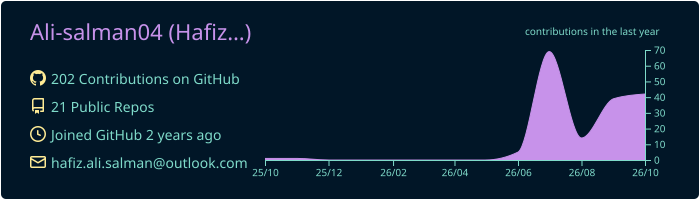
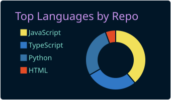
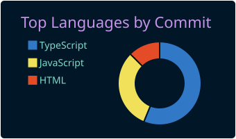
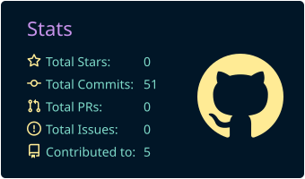
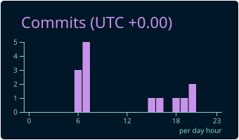

<!-- ===================== HERO ===================== -->
<div align="center">


<a href="https://readme-typing-svg.demolab.com">
  
</a>

<br/>

<a href="https://www.linkedin.com/in/hafiz-ali-salman-40715a250/"></a>
<a href="mailto:halisalman04@gmail.com"></a>
<a href="https://github.com/Ali-salman04"></a>
<a href="https://wa.me/923181469544"></a>


<br/>


</div>


<!-- ===================== SNAPSHOT ===================== -->
<div align="center">

| 🏥 **Currently** | 🔌 **Integrations** | 🧩 **UI Systems** | ⚡ **Stack** |
| :---: | :---: | :---: | :---: |
| US-based healthcare RCM product | Epic · Oracle Health · Stedi · Optum | 26 modules · 50+ components | Next.js · React · TypeScript · Node |

</div>


<!-- ===================== ABOUT ===================== -->
## 👤 About Me

<table>
<tr>
<td width="56%" valign="top">

```ts
const hafiz: Engineer = {
  role       : "Full-Stack Engineer",
  industry   : "Healthcare SaaS · RCM",
  product    : "US-based, production-grade",
  team       : "Outstanding, high-performing engineers",
  location   : "Lahore, Pakistan 🇵🇰",
  education  : "BS Software Engineering @ UMT",
  stack      : ["Next.js", "React", "TypeScript", "Node.js", "PostgreSQL"],
  focus      : "Third-party integrations, scalable APIs & UI architecture",
  philosophy : "Working exceptionally well > working a lot",
  funFact    : "Ship clean. Break nothing. Sleep well. 😴",
};
```

</td>
<td width="44%" valign="top">

- 🏥 &nbsp;Building a **production healthcare RCM** platform for the US market
- 🔌 &nbsp;Integrating **EHR systems** (Epic, Oracle Health) and **clearinghouse APIs** (Stedi, Optum) for claims, eligibility & claim status
- 🧩 &nbsp;Shipped a **reusable component library**: 26 modules, 50+ components
- 🎯 &nbsp;Turning ideas into **stable, scalable** products with **Next.js & MERN**
- 🌱 &nbsp;Deepening **system design** & **UI architecture**
- 💬 &nbsp;Ask me about **React, Next.js, TypeScript, Node**
- ⚡ &nbsp;Motto: *clean code, fast architecture, zero tech debt*

</td>
</tr>
</table>


<!-- ===================== WHAT I DO ===================== -->
## 💎 What I Do

<table>
<tr>
<td width="33%" valign="top" align="center">

### 🔌 Integrations
Healthcare data exchange with **Epic** and **Oracle Health**, plus claim submission, eligibility verification and claim status tracking through **Stedi** and **Optum**.

</td>
<td width="33%" valign="top" align="center">

### 🧱 Scalable Interfaces
Responsive, maintainable UIs in **React, Next.js & TypeScript**, built on reusable primitives for consistency and performance.

</td>
<td width="33%" valign="top" align="center">

### 🚀 End-to-End Delivery
**MERN** and **Next.js** apps from component architecture and REST APIs to database and deployment.

</td>
</tr>
</table>


<!-- ===================== TECH STACK ===================== -->
## 🛠️ Tech Arsenal

<div align="center">

#### 💻 Languages


#### ⚛️ Frameworks & Styling

<br/>


#### 🧰 Tools & Platforms


</div>

<br/>

### 📋 Skills at a Glance

| Category | Technologies | Level |
| :--- | :--- | :---: |
| **Languages** | TypeScript · JavaScript · SQL (PostgreSQL) · HTML/CSS | 🟡🟡🟡🟡 |
| **Frontend** | Next.js · React · Tailwind CSS · shadcn/ui | 🟡🟡🟡🟡 |
| **Backend** | Node.js · Express.js · REST APIs | 🟡🟡🟡⚫ |
| **Database** | MongoDB · PostgreSQL | 🟡🟡🟡⚫ |
| **Tools** | Git · GitHub · Docker · Postman · Vercel · VS Code | 🟡🟡🟡🟡 |


<!-- ===================== TROPHIES ===================== -->
## 🏆 GitHub Trophies

<div align="center">


</div>


<!-- ===================== EXPERIENCE ===================== -->
## 💼 Experience

> ### 🏥 &nbsp; Full-Stack Developer — **MedSynthea**
> `May 2026 – Present` · Lahore, Pakistan · US-based healthcare RCM product
>
> - Build responsive, scalable interfaces for a **production healthcare RCM** product with React.js, Next.js, Node.js, PostgreSQL & TypeScript.
> - Integrated third-party **EHR systems (Epic, Oracle Health)** to exchange clinical and patient data within the platform.
> - Integrated **clearinghouse APIs (Stedi, Optum)** for claim submission, eligibility verification and claim status tracking.
> - Built a **reusable component library**: 26 modules, 50+ components across Dashboard, Clinical, Admin & RCM.
> - Working alongside an outstanding, high-performing engineering team.

> ### ⚙️ &nbsp; Associate Full-Stack Developer — **DMZ Dev Hub**
> `Jan 2025 – Feb 2026` · Lahore, Pakistan
>
> - Delivered **MERN-stack** web apps end to end, from component architecture to deployment.
> - Integrated REST APIs and optimized performance, improving responsiveness and system efficiency.
> - Partnered with the team to ship high-quality, user-centric software.

> ### 🌱 &nbsp; Software Engineer Intern — **DMZ Dev Hub**
> `Jul 2024 – Dec 2024` · Lahore, Pakistan
>
> - Built UI components and integrated REST APIs with React.js, TypeScript & Tailwind CSS.
> - Fixed bugs and managed code changes with Git in a collaborative workflow.
> - Supported senior developers in shipping client web apps on schedule.


<!-- ===================== PROJECTS ===================== -->
## 🚀 Featured Projects

<table>
<tr>
<td width="50%" valign="top">

### 🩺 Face Derma AI
`Aug 2024 – Sep 2025` · **Final Year Project**

AI-powered healthcare platform that detects skin conditions through **image-based analysis**. Includes detailed skin reports, dermatologist profiles, location-based assistance, an intelligent chatbot and product recommendations.


</td>
<td width="50%" valign="top">

### ☀️ Active Technology
`Aug 2024 – Sep 2025` · **Client Project**

A responsive digital presence for a solar-energy company with modern UI/UX and a strong focus on performance. Features **dark/light mode**, clean iconography and real-time **WhatsApp chat** integration.


</td>
</tr>
</table>


<!-- ===================== EDUCATION & CERTS ===================== -->
## 🎓 Education & Certifications

| 🎓 Education | 🏅 Certifications |
| :--- | :--- |
| **BS Software Engineering**<br/>University of Management & Technology (UMT), Lahore<br/>`Oct 2021 – 2025` | **Claude Code in Action** — Anthropic<br/>**Docker Foundations** — LinkedIn Learning |


<!-- ===================== STATS ===================== -->
## 📊 GitHub Analytics

<div align="center">


<br/>


<br/>


</div>


<!-- ===================== PROFILE SUMMARY CARDS (generated by GitHub Action) ===================== -->
## 🧾 Profile Summary

<div align="center">



<br/>




<br/>




</div>


<!-- ===================== QUOTE ===================== -->
## 💭 Dev Quote

<div align="center">


</div>


<!-- ===================== TESTIMONIAL ===================== -->
## ⭐ What People Say

> *"Hafiz Ali is one of the best developers I have ever worked with. He delivers quality work — recently we worked together on a food system web platform and he delivered great results."*
>
> — **Muhammad Usman Cheema**, Performance Marketing Specialist


<!-- ===================== CONTACT ===================== -->
<div align="center">

## 📫 Let's Build Something Great

Always open to discussing **projects, collaborations, or a good technical challenge**.

<a href="https://www.linkedin.com/in/hafiz-ali-salman-40715a250/"></a>
<a href="mailto:halisalman04@gmail.com"></a>
<a href="https://wa.me/923181469544"></a>
<a href="https://github.com/Ali-salman04"></a>

<br/><br/>

⭐️ From [Ali-salman04](https://github.com/Ali-salman04), *thanks for stopping by!*


</div>
