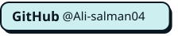
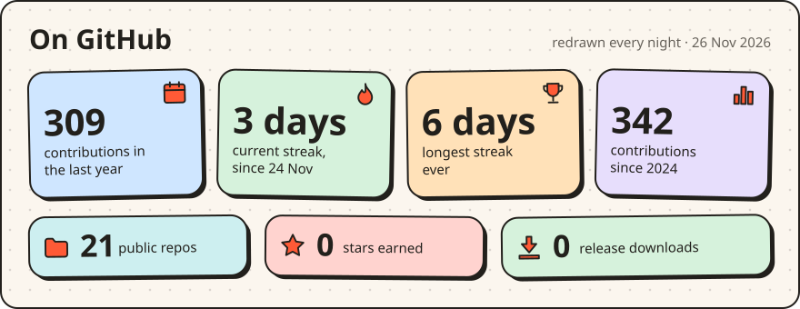
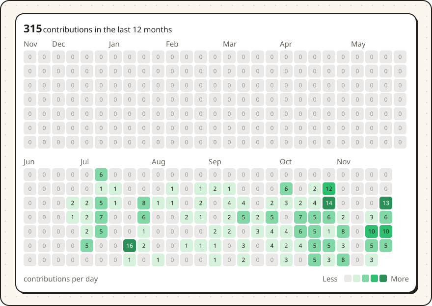
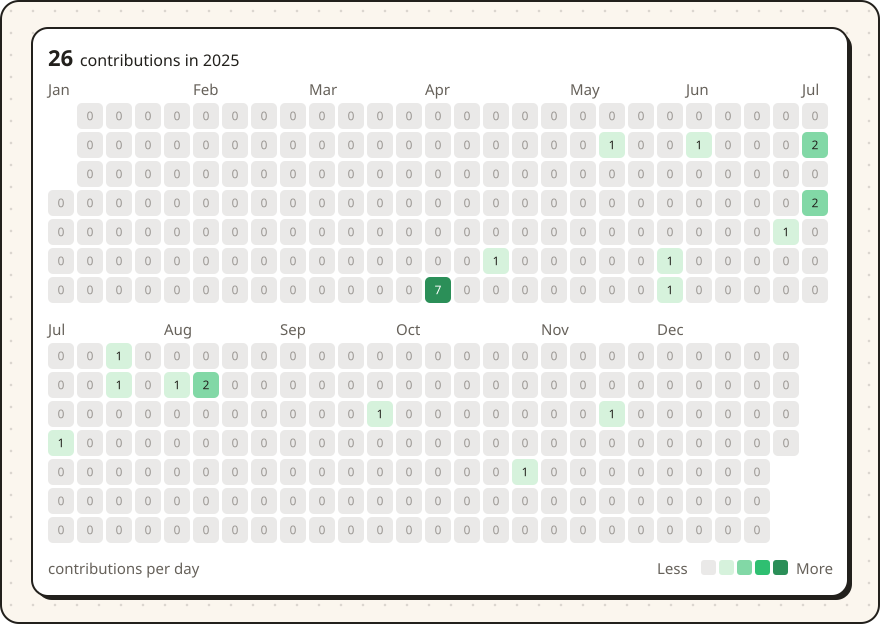
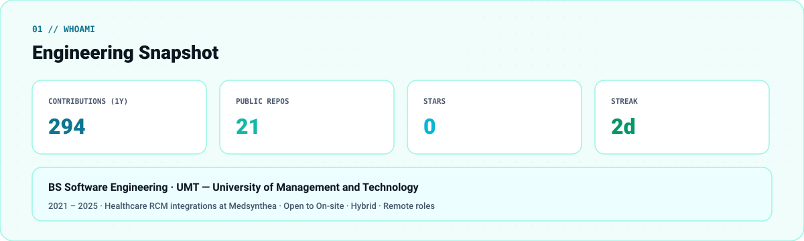
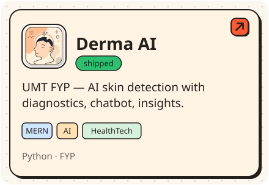
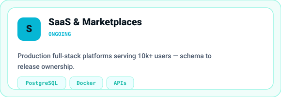

<!-- HAFIZ ALI SALMAN — generated by scripts/build.py; do not edit by hand -->
<a href="https://github.com/Ali-salman04"><picture>
  <source media="(prefers-color-scheme: dark)" srcset="assets/hero-dark.svg">
  
</picture></a>

<a href="https://github.com/Ali-salman04"><picture>
  <source media="(prefers-color-scheme: dark)" srcset="assets/badge-gh-dark.svg">
  
</picture></a> <a href="https://www.linkedin.com/in/hafiz-ali-salman"><picture>
  <source media="(prefers-color-scheme: dark)" srcset="assets/badge-li-dark.svg">
  
</picture></a> <a href="mailto:halisalman04@gmail.com"><picture>
  <source media="(prefers-color-scheme: dark)" srcset="assets/badge-email-dark.svg">
  
</picture></a>

<picture>
  <source media="(prefers-color-scheme: dark)" srcset="assets/github-dark.svg">
  
</picture>

<b>Last 12 months</b>: 293 contributions

<picture>
  <source media="(prefers-color-scheme: dark)" srcset="assets/graph-12m-dark.svg">
  
</picture>

 

<b>2026</b>: 293 contributions

<picture>
  <source media="(prefers-color-scheme: dark)" srcset="assets/graph-2026-dark.svg">
  
</picture>

 

<b>2025</b>: 26 contributions

<picture>
  <source media="(prefers-color-scheme: dark)" srcset="assets/graph-2025-dark.svg">
  
</picture>

 

<b>2024</b>: 7 contributions

<picture>
  <source media="(prefers-color-scheme: dark)" srcset="assets/graph-2024-dark.svg">
  
</picture>

 

<picture>
  <source media="(prefers-color-scheme: dark)" srcset="assets/whoami-dark.svg">
  
</picture>

<picture>
  <source media="(prefers-color-scheme: dark)" srcset="assets/label-ship-dark.svg">
  
</picture>

<a href="https://github.com/Ali-salman04"><picture>
  <source media="(prefers-color-scheme: dark)" srcset="assets/app-medsynthea-dark.svg">
  
</picture></a> <a href="https://github.com/Ali-salman04"><picture>
  <source media="(prefers-color-scheme: dark)" srcset="assets/app-derma-ai-dark.svg">
  
</picture></a>
 
<a href="https://github.com/Ali-salman04"><picture>
  <source media="(prefers-color-scheme: dark)" srcset="assets/app-active-tech-dark.svg">
  
</picture></a> <a href="https://github.com/Ali-salman04"><picture>
  <source media="(prefers-color-scheme: dark)" srcset="assets/app-saas-dark.svg">
  
</picture></a>

More ships: <a href="https://github.com/Ali-salman04/Ru-Novel">Ru-Novel</a> · <a href="https://github.com/Ali-salman04/School-Record-Inventory">School-Record-Inventory</a> · <a href="https://github.com/Ali-salman04/Expense-App">Expense-App</a> · <a href="https://github.com/Ali-salman04/Portfilo">Portfilo</a>

Drawn in the Hafiz Ali Salman teal design system · numbers redrawn nightly by a GitHub Action · 
<a href="https://www.linkedin.com/in/hafiz-ali-salman">LinkedIn</a> · <a href="https://github.com/Ali-salman04">GitHub</a>

